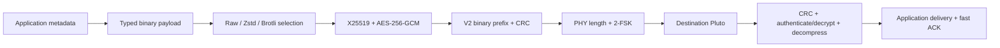
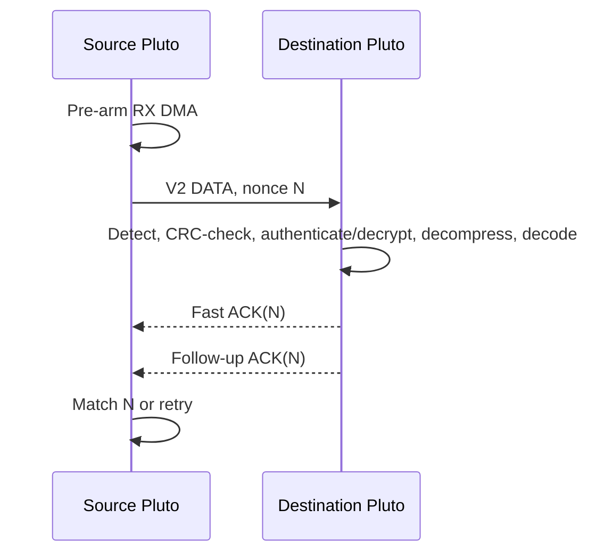

# Pluto JSON Radio: V2 Binary Protocol

## Scope

V2 is the active on-air protocol: a binary typed payload carried by the Pluto
2-FSK modem with a fixed fast ACK waveform.



## Frame and Header

```text
preamble | 16-bit PHY length | V2 binary packet

P2 | version | destination ID (8) | nonce (8) |
AES-GCM ciphertext and tag:
  source ID (8) | type | flags | TTL | max hops | compression |
  fragment ID (4) | total fragments (varint) | fragment number (varint) |
  compressed binary payload | Ed25519 sender signature (64)
CRC-32 (4)
```

The PHY length defines the end of the packet, so V2 does not send a redundant
payload-length field. A secure single-fragment packet has a 122-byte fixed
minimum before application metadata: 19-byte clear prefix, 19-byte protected
protocol metadata, 64-byte encrypted signature, 16-byte AES-GCM tag, and
4-byte CRC.

| Header field | Encoding |
| --- | --- |
| Magic/version | `P2`, then byte `2` |
| Clear prefix | only `P2`, version, destination ID, and ACK nonce |
| Packet type, flags, TTL/hops | one-byte values inside the encrypted body |
| Compression | raw=0, Zstandard=1, Brotli=2; encrypted inside the body |
| Source ID | configured numeric ID, encrypted inside the body |
| Sender signature | 64-byte Ed25519 value, encrypted inside the body |
| Nonce | 8 random bytes; bound into AES-GCM and used as ACK correlation key |
| Fragment fields | encrypted; fragment ID is first 32 bits of nonce, counters are unsigned varints |
| CRC | CRC-32 of binary header and wire payload |

## Binary Payload Codec

Application metadata is a typed binary map, not JSON. Known keys are one-byte
dictionary IDs: timestamp=1, text=2, experiment=3, temperature=4, GPS=5,
battery=6, route=7, and sequence=8. Unknown keys are UTF-8 only once.

| Value | Encoding |
| --- | --- |
| null / false / true | one-byte tag |
| integer | signed zigzag varint |
| float | IEEE-754 64-bit |
| string / bytes | tag + varint length + bytes |
| list / map | typed recursive entries |

This removes JSON punctuation and repeated field names while preserving nested
metadata. V2 has no stateful delta encoding or telemetry batching yet.

## Compression

Compression operates only on the serialized binary payload, never routing or
reliability headers. `--compression` or metadata `compression_method` accepts:

```text
auto    complete V2 packet <=150 bytes stays raw; otherwise try Brotli if smaller
zstd    force Zstandard level 3
brotli  force Brotli quality 4
none    force raw payload
```

Above 150 complete V2 packet bytes, `auto` compares raw and Brotli byte lengths and stores Brotli
only when it is smaller. Zstandard remains a manual `zstd` override. The
receiver decrypts before reading the compression enum.

## Encryption and Key Configuration

`security.encryption_method: x25519-aesgcm` is enabled in both supplied YAML
files. Each folder holds only its node's base64-encoded X25519 `private_key`.
The `peer_public_keys` map contains public keys received from peers. X25519
derives a per-peer secret, HKDF-SHA256 derives an AES-256 key, and AES-GCM
encrypts and authenticates all packet metadata except the minimal destination
and nonce. The outer prefix is authenticated as associated data, so it cannot
be altered without decryption failing. To avoid exposing a source/key selector,
the addressed receiver tries its configured peer encryption keys; a successful
AES-GCM decrypt reveals the encrypted source ID, which must match that peer.

Each folder additionally holds a distinct Ed25519 `signing_private_key` and
the peer's identity under `peer_signing_public_keys`. The sender signs the
routing prefix plus the unsigned inner metadata. That 64-byte signature is
then encrypted alongside the metadata. The addressed receiver decrypts using
each configured peer key, checks the hidden source ID, then verifies the
hidden signature before delivery or ACK. This prevents metadata leakage while
retaining sender authentication.

Compression occurs before encryption. The fixed fast ACK remains a short
plaintext CRC-protected nonce waveform so ACK detection stays low latency.

Generate a replacement key pair in either standalone folder with:

```bash
PYTHONPATH=. ./.venv/bin/python -m pluto_json_radio.keys --kind all
```

Put the generated X25519 `private_key` and Ed25519 `signing_private_key` only
in that folder's `security` section. Copy each public key into the respective
peer map (`peer_public_keys` or `peer_signing_public_keys`) using this node's
address as the map key. Restart both receivers after a key change.

## ACK, Retries, and PHY



ACKs are separate fixed 16-byte binary frames: `PJRA | nonce(8) | CRC-32`.
The receiver ACKs duplicates but delivers each nonce only once. Each ACK burst
contains two copies, with three follow-up bursts. There is one initial
transmission, a 180 ms ACK timeout, and up to four resends. PHY: 866.5 MHz,
2 MS/s, 2-FSK, 8 samples/symbol, ±125 kHz tones.

## Node Configuration

Both folders have identical source, dependencies, dictionary, and PHY settings.
Only device identity differs:

| Folder | URI | Local ID | Peer |
| --- | --- | --- | --- |
| `oka` | `ip:172.31.242.1` | `mac-b` / node 2 | `mac-a` / node 1 |
| `oka_` | `ip:172.31.241.1` | `mac-a` / node 1 | `mac-b` / node 2 |

Run RX only on the destination Pluto and TX only on the source Pluto. Do not
open separate TX and RX processes against the same Pluto.

## Implementation Status

Implemented: binary header/CRC, binary node IDs, enums, short fragment IDs,
varints, dictionary-coded typed metadata, payload-only adaptive compression,
X25519/AES-256-GCM authenticated encryption, Ed25519 sender signatures,
V2 receiver decoding, address restoration, and fast ACK delivery.

Future work: multi-fragment reassembly, delta state synchronization, telemetry
batches, key rotation, relaying, and TTL decrement.

## Verification

```bash
PYTHONPATH=. ./.venv/bin/pytest -q
PYTHONPATH=. ./.venv/bin/python -m pluto_json_radio.tx \
  --config configs/pluto.example.yaml --text "V2 dry run" --dry-run
```

The automated suite verifies V2 binary encode/decode, CRC, FSK modem recovery,
address restoration, compression choices, and ACK/PHY behavior.
